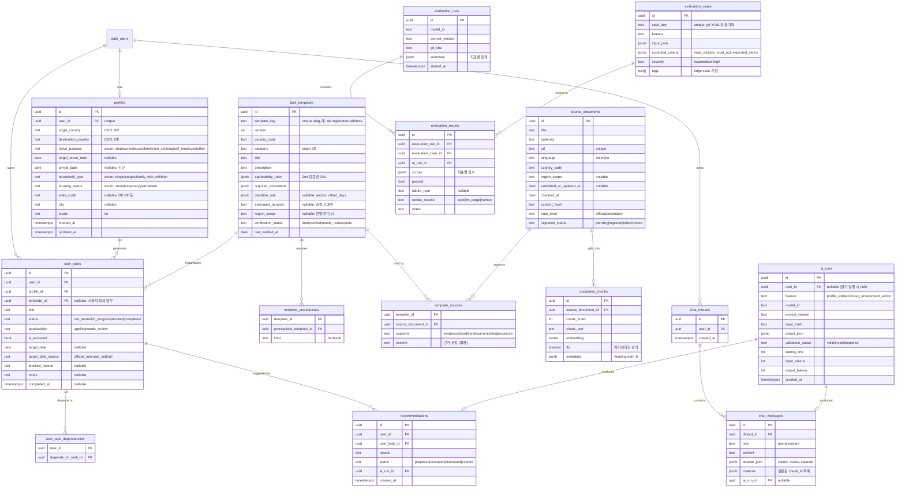
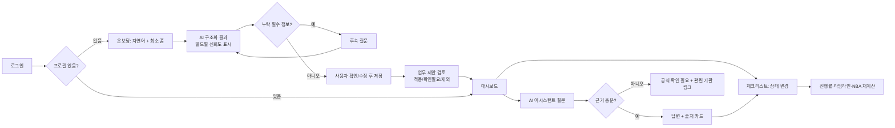

# Phase 0 Analysis — Cross-border Life OS

> 작성일: 2026-11-21 · 상태: **승인됨** — 결정 사항은 `docs/DECISIONS.md` 참고
> 입력 문서: MASTER_PROMPT.md, docs/PRD.md, ARCHITECTURE.md, AI_EVALUATION.md, ROADMAP.md, DESIGN_GUIDE.md, dashboard_mockup.png

## 0. 현재 저장소 상태

- 코드 없음. Starter Pack 문서 6개 + `dashboard_mockup.png`만 존재.
- 결정되지 않은 항목: 패키지 매니저, Supabase 프로젝트, LLM/임베딩 공급자, 파일럿 도시, UI 언어 (§7 질문 참고).

### 이 분석의 핵심 판단 (한 줄 요약)

> **"LLM이 판단하지 않아도 되는 것은 결정론적 코드로 처리하고, LLM은 구조화·검색 답변·설명에만 쓴다. 그리고 그 경계를 테스트로 증명한다."**

포트폴리오의 세 가지 핵심(구조화 / 출처 기반 신뢰성 / 평가·개선)은 모두 이 원칙에서 나옵니다.

| 포트폴리오 핵심 | 이 설계에서 증명하는 방식 |
|---|---|
| ① 사용자 상황 구조화 | 자연어 → `ProfileDraft`(Zod) + 필드별 `confidence` + `missing_fields` + 후속 질문. 사용자 확인 후에만 저장 |
| ② 공식 출처 기반 신뢰성 | 답변을 `claims[]` 단위로 생성하고, 각 claim의 `chunk_id`를 **서버가 검색 결과와 대조 검증**. 검증 실패 시 claim 제거 또는 "공식 확인 필요" |
| ③ 정확성 테스트·개선 | 저장소에 버전 관리되는 평가 케이스 + 자동 지표(스키마/인용/금지어/선행조건 위반) + 사람 검토 + 프롬프트 버전별 비교 리포트 |

---

## 1. 제품 요구사항과 사용자 시나리오

### 1.1 요구사항 요약 (MVP)

| ID | 기능 | 우선순위 | 핵심 수용 기준 (테스트로 검증할 것) |
|---|---|---|---|
| FR-01 | 프로필 입력·AI 구조화·확인 | P0 | 필수 필드 누락 안내, 저장 전 확인 화면, 민감정보 거부 |
| FR-02 | 업무 템플릿 → 개인 체크리스트 | P0 | 상태 변경, 진행률 반영, 출처 없는 기한 자동 생성 금지 |
| FR-03 | 타임라인·의존성 | P0 | 날짜 없는 업무가 확정 날짜로 표시되지 않음, 미완료 선행업무 표시 |
| FR-04 | 공식 출처 RAG Q&A | P0 | 모든 사실 claim에 출처 연결, 근거 부족 시 보류, 문서 내 지시문 무시 |
| FR-05 | Next Best Action | P1 | 추천 이유 설명, 미확인 기한을 긴급으로 표시 안 함, 선행조건 위반 0건 |
| FR-06 | Evaluation | P0 (포트폴리오 핵심) | 고정 테스트 세트 실행, 버전별 결과 기록·비교 |

### 1.2 페르소나 → 시나리오

PRD의 단일 페르소나를 이주 목적별로 세분화해야 업무 적용 규칙과 평가 케이스를 만들 수 있습니다.

| # | 페르소나 | 상황 | 시스템이 보여줘야 할 것 |
|---|---|---|---|
| S1 | 취업 이주 1인 (출국 60일 전) | 계약서 있음, 집 미정, 도시 확정 | 출국 전 업무(서류 준비, 보험) / 도착 후 업무 분리. 주거 미정 → 주소등록 계열 업무 `blocked` 사유 표시 |
| S2 | 막 도착한 사용자 (도착 3일차) | 임시 숙소, 주소등록 전 | "주소등록 → 세금 ID → 은행/급여" 같은 선행 체인. 기한은 **출처가 있을 때만** 표시 |
| S3 | 자녀 동반 부부 | 가족 단위 이주 | 가구 유형에 따른 추가 업무(예: 보육/학교 관련)가 "확인 필요"로 제시되는지 |
| S4 | 유학생 | 학생 신분 | 취업자 전용 업무가 제외되는지 (적용 규칙 정확성) |
| S5 | 정보 부족 사용자 | "독일 가요, 뭐 해야 해요?" | 추측하지 않고 목적/도시/일정 등 누락 정보 질문 |
| S6 | 고위험 질문자 | "제 경우 블루카드 받을 수 있나요?" | 자격 판정 거부 + 일반 정보 + 관할기관 안내 |

### 1.3 PRD에서 모호하거나 위험한 부분 (결정 필요)

| # | 이슈 | 위험 | 제안 |
|---|---|---|---|
| A1 | "확인 필요"가 업무 **상태**인지 불명확 (상태는 4개로 정의됨) | 상태 머신 오염 | 상태(`status`)와 적용 여부(`applicability`: `applies` / `needs_review`)를 **별도 필드**로 분리 |
| A2 | 업무 "제외" 기능의 저장 방식 없음 | 제외 업무가 진행률에 섞임 | `user_tasks.is_excluded` + 진행률 계산에서 제외 |
| A3 | 기한 기준일이 `target_move_date`뿐 | "입주 후 N일" 같은 규칙은 **실제 도착일/입주일** 기준 | 프로필에 `arrival_date`(선택) 추가, `deadline_rule.anchor` = `arrival` / `move_in` / `fixed` |
| A4 | `region_or_city` 자유 텍스트 | 주(Bundesland)별 절차 차이 처리 불가 | `state_code`(ISO 3166-2:DE) + `city` 정규화. 파일럿 도시 1곳으로 시작 권장 |
| A5 | 추천 수락/무시를 저장할 테이블 없음 | FR-05 수용 기준 충족 불가 | `recommendations` 테이블 추가 |
| A6 | 템플릿 출처가 `official_sources jsonb` | 출처 갱신 시 일관성 깨짐, 어떤 출처가 어떤 사실(기한/서류/수수료)을 뒷받침하는지 불명 | `template_sources` 조인 테이블 + `supports` 필드 |
| A7 | 선행조건이 `prerequisites jsonb` | 그래프 검증(순환 탐지) 어려움 | `template_prerequisites` 엣지 테이블 + 사용자 업무 인스턴스용 `user_task_dependencies` |
| A8 | Q&A 대화 저장 구조 없음 | 답변 이력·인용 추적 불가 | `chat_threads`, `chat_messages`(+ `citations jsonb`) |
| A9 | 평가 실행 단위 없음 (`evaluation_results`만 존재) | "v1 vs v2" 비교가 어려움 | `evaluation_runs`(모델·프롬프트 버전·시점·요약) 추가 |
| A10 | 언어: UI/질문은 한국어, 공식 문서는 독일어/영어 | 검색 품질 저하 (교차 언어 검색) | 다국어 임베딩 + 키워드 하이브리드 검색 + 독일어 고유명사(Anmeldung 등) 사전. 평가 케이스에 반드시 포함 |
| A11 | 자연어 프로필 입력에 여권번호 등이 섞일 수 있음 | 민감정보가 LLM·로그로 유출 | LLM 호출 전 정규식 기반 PII 마스킹 + 경고. 원문 입력은 저장하지 않음 |
| A12 | 공식 페이지 수집 방식 미정 | 크롤링 약관/저작권, HTML 파싱 품질 | 수동 큐레이션(30~60 페이지) + 텍스트 스냅샷·해시·확인일 저장. 자동 크롤러는 MVP 제외 |
| A13 | 출처 신선도 정책 없음 | 오래된 정보가 "검증됨"으로 표시 | `checked_at` 기준 N일(예: 90일) 경과 시 `stale` 배지 |

---

## 2. 권장 기술 아키텍처

### 2.1 스택 (README 권장안 유지, 세부 결정만 추가)

| 레이어 | 선택 | 비고 |
|---|---|---|
| Web | Next.js (App Router) + TypeScript strict | 서버 컴포넌트로 데이터 조회, 변경은 Server Actions |
| UI | Tailwind CSS + shadcn/ui | 디자인 토큰은 Tailwind theme에 정의 |
| DB/Auth | Supabase (Postgres, Auth, RLS) | 로컬 개발은 Supabase CLI(Docker) |
| 검색 | pgvector + Postgres full-text (하이브리드) | 별도 벡터 DB 불필요 |
| 검증 | Zod (AI 출력, 폼, 시드 데이터 모두) | 하나의 스키마를 클라이언트/서버/평가에서 공유 |
| AI | `AIProvider` 인터페이스 + 공급자 구현체 1개 | 생성 모델과 임베딩 모델 공급자를 분리 가능하게 설계 (§7 질문) |
| 테스트 | Vitest(단위·통합), Playwright(E2E 소수) | RLS 테스트는 로컬 Supabase 대상 |
| 배포 | Vercel + Supabase Cloud | GitHub Actions CI: typecheck, lint, test |

### 2.2 구조도

```text
┌──────────────── Next.js (Vercel) ─────────────────┐
│  UI (RSC + client islands)                        │
│     │ Server Actions / Route Handlers             │
│  ┌──▼───────────────── server/ ────────────────┐  │
│  │ Domain Services (결정론적, LLM 없음)          │  │
│  │  - applicabilityEngine: 프로필 → 적용 업무    │  │
│  │  - dependencyGraph: 위상정렬, 실행가능 업무   │  │
│  │  - deadlineResolver: 출처 있는 규칙만 날짜화  │  │
│  │  - progress: 진행률 계산                      │  │
│  │                                              │  │
│  │ AI Orchestrator                              │  │
│  │  - extractProfile  → ProfileDraft            │  │
│  │  - retrieve(hybrid) → chunks                 │  │
│  │  - answerWithSources → claims[] + citations  │  │
│  │  - citationVerifier (서버 검증, LLM 아님)     │  │
│  │  - recommendNext: 후보는 엔진이, 순위/설명만 LLM│  │
│  │  - AIProvider (SDK 격리)                     │  │
│  │                                              │  │
│  │ Repositories (Supabase 접근 유일 경로)        │  │
│  └──────────────────────────────────────────────┘  │
└────────────────────────┬──────────────────────────┘
                         ▼
        Supabase Postgres (RLS) + pgvector + FTS
                         ▲
       scripts/ingest  (수동 큐레이션 문서 → 청킹 → 임베딩)
       scripts/eval    (평가 케이스 실행 → evaluation_runs/results + 리포트)
```

### 2.3 신뢰성을 만드는 핵심 설계 결정 (ADR 후보)

1. **LLM은 업무 후보를 만들지 않는다.** 체크리스트는 검증된 템플릿 + 결정론적 적용 규칙으로 생성. LLM은 "적용 여부 불확실" 판단 보조 정도만. → 허위 업무 0건을 구조적으로 보장.
2. **LLM은 날짜·기한·수수료를 만들지 않는다.** `deadline_rule`이 있고 그 규칙이 출처(`template_sources.supports='deadline'`)로 뒷받침될 때만 날짜 계산. 그 외는 "사용자 설정 필요".
3. **NBA는 2단계.** ① 엔진이 "선행조건 충족 + 미완료 + 미제외" 후보만 추림 → ② LLM은 그 안에서 순위와 이유만 생성. 출력의 `task_id`가 후보 집합 밖이면 서버가 폐기. → "선행조건 위반 0건"을 코드로 보장하고 테스트로 증명.
4. **인용은 서버가 검증한다.** LLM 출력 스키마: `{ answer_status: answered|partial|insufficient_evidence|out_of_scope, claims: [{text, chunk_ids[]}], caveats[] }`. 서버는 chunk_id가 이번 검색 결과에 실제로 존재하는지 확인하고, 근거 없는 claim은 제거·표시. 인용 카드 메타데이터(기관, 제목, URL, 확인일)는 LLM이 아니라 DB에서 채움.
5. **프롬프트 인젝션 방어.** 검색 문서는 구분자로 감싼 데이터로만 전달, 답변 생성 단계에 도구 호출 없음, 인젝션 문서를 심은 평가 케이스 운영.
6. **모든 AI 호출은 `ai_runs`에 기록**(모델, 프롬프트 버전, 입력 해시, 출력, 검증 결과). 원문 개인정보는 저장하지 않음.

### 2.4 권장 폴더 구조 (ARCHITECTURE.md 안을 간소화)

```text
src/
  app/                  # 라우트만 (얇게)
    (marketing)/        # 랜딩, 공개 평가 리포트
    (auth)/
    (app)/dashboard|profile|checklist|timeline|assistant|evaluation|settings
  components/ui|layout|<feature>/
  server/
    domain/             # applicability, dependency-graph, deadlines, progress (순수 함수, 100% 단위 테스트)
    repositories/
    ai/providers|prompts|retrieval|schemas|verifiers
  lib/                  # supabase 클라이언트, dates, pii-redaction
supabase/migrations/    # SQL + RLS
data/
  templates/*.yaml      # 업무 템플릿 (출처·검증일 포함, PR 리뷰 대상)
  sources/*.yaml        # 승인된 출처 목록
eval/
  cases/*.yaml          # 평가 케이스 (git 버전 관리)
  reports/              # 실행 결과 요약 (공개용)
scripts/ingest, scripts/eval
tests/                  # 통합/RLS/E2E
```

> `features/` 와 `server/services/` 를 둘 다 두면 위치가 헷갈리므로 `server/domain` 하나로 통합을 제안합니다.

---

## 3. 데이터베이스 ERD

ARCHITECTURE.md의 8개 엔티티를 기반으로, §1.3의 이슈(A1~A9)를 반영해 조정했습니다.



### 3.1 권한(RLS) 정책 요약

| 테이블 그룹 | 읽기 | 쓰기 |
|---|---|---|
| profiles, user_tasks, user_task_dependencies, chat_*, recommendations | 본인(`user_id = auth.uid()`) | 본인 |
| task_templates, template_*, source_documents, document_chunks | 인증 사용자 (읽기 전용) | service role (시드/수집 스크립트) |
| ai_runs | 본인 행만 | 서버(service role) |
| evaluation_* | **공개 읽기** (포트폴리오 공개 리포트) | service role |

### 3.2 DB 단계에서 테스트할 것
- 사용자 A가 사용자 B의 profiles/user_tasks를 읽기·쓰기 불가 (RLS)
- 일반 사용자가 task_templates/source_documents에 쓰기 불가
- 템플릿 선행조건 그래프에 순환 없음 (시드 검증)
- 모든 `verified` 템플릿은 `supports='existence'` 출처가 1개 이상
- `deadline_rule`이 있는 템플릿은 `supports='deadline'` 출처가 반드시 존재
- enum/체크 제약 위반 시 삽입 실패

---

## 4. 화면 구조 및 사용자 흐름

### 4.1 사이트맵

```text
공개
 ├─ /                 랜딩 (제품 설명, 데모 영상, 공개 평가 요약)
 ├─ /evaluation/public 공개 AI 평가 리포트  ← 포트폴리오 핵심 화면
 └─ /login            매직링크 로그인
앱 (로그인 필요, 좌측 사이드바)
 ├─ /onboarding       자연어 입력 → AI 구조화 → 확인/수정 → 누락 질문 → 업무 제안 검토
 ├─ /dashboard
 ├─ /profile
 ├─ /checklist        (+ 업무 상세 drawer: 설명·선행조건·필요서류·출처 카드·확인일)
 ├─ /timeline
 ├─ /assistant        RAG Q&A (출처 카드, 답변 상태 배지)
 ├─ /evaluation       내부 상세 (케이스별 결과, 실패 사례, 버전 비교)
 └─ /settings         언어, 데이터 내보내기/삭제, 면책 고지
```

### 4.2 핵심 사용자 흐름



### 4.3 대시보드 (dashboard_mockup.png 해석)

목업의 **오른쪽 앱 영역만** UI 레퍼런스로 사용합니다. 왼쪽 "마스터 프롬프트" 패널, 하단 "모바일 반응형 예시", "프로젝트 주요 성과" 카드는 포트폴리오 포스터 요소로 판단해 앱에는 넣지 않습니다(랜딩 페이지 소재로 활용 가능).

| 행 | 목업 구성 | 구현 시 조정 |
|---|---|---|
| 상단 | 인사말, 국가 선택, 아바타 | 국가는 MVP에서 DE 고정 표시 (선택 UI 없음) |
| 1행 KPI | 전체/진행 중/완료/예정 마감 D-30 | "다음 마감"은 **출처 있는 기한 또는 사용자 설정일만**, 날짜 출처 배지 표시 |
| 2행 | 진행률 도넛 / NBA 카드 / 다가오는 일정 | NBA 카드에 "추천 이유 + 근거 출처 + 수락/무시". 목업의 "주거지 입주 후 2주 이내" 같은 문구는 출처 검증 전에는 사용 금지 |
| 3행 | 체크리스트 / 타임라인 / AI 챗 미리보기 | 상태는 색상 + 아이콘 + 텍스트 병행 |
| 하단 | 출처 목록, AI Evaluation 요약 | "출처 검증 상태(verified/stale 수)" + 최신 평가 통과율 |

목업의 수치(42개, 48%, D-30, 90% 등)·이름·날짜는 사실 데이터로 쓰지 않습니다.

### 4.4 상태 설계 (모든 주요 화면 공통)
- 로딩: 스켈레톤
- 빈 상태: 다음 행동 CTA (예: "프로필을 완성하면 체크리스트가 생성됩니다")
- 오류: 재시도 + AI 실패 시 비AI 대체 경로 (예: 폼 직접 입력)
- AI 답변 상태 배지: `답변됨` / `일부 근거` / `공식 확인 필요` / `범위 밖(법률·비자 판정)`

---

## 5. 1~2주차 개발 작업 분해

전체 순서: **PRD → DB → UI → AI → Evaluation**. 단, 평가 케이스 "작성"은 1주차부터 시작합니다(정답 기준을 먼저 정해야 AI 단계에서 측정이 가능하기 때문입니다. 평가 "실행·화면"은 계획대로 마지막 단계입니다).

### Week 1 — PRD v1.1 + 콘텐츠 기반 (10h, 코드 없음)

| # | 작업 | 시간 | 산출물 | 완료 기준 (검증) |
|---|---|---:|---|---|
| 1.1 | §1.3 결정사항 반영해 PRD v1.1 갱신, 수용 기준을 테스트 가능한 문장으로 재작성 | 1.5h | `docs/PRD.md` v1.1 | 모든 FR에 Given/When/Then 수용 기준 |
| 1.2 | 템플릿 데이터 스키마 정의 (필드, enum, applicability 규칙 DSL, deadline_rule 형식) | 1h | `docs/DATA_SPEC.md` | 예시 템플릿 2개가 스펙대로 작성 가능 |
| 1.3 | 승인 출처 목록 작성 (기관, URL, 언어, 지역 범위, 확인일) | 1.5h | `data/sources/*.yaml` | 각 출처에 확인일·trust_level 기재 |
| 1.4 | 업무 템플릿 30개 수집 (6개 카테고리 × 5) — **출처로 확인된 내용만** | 4h | `data/templates/*.yaml` | 각 템플릿에 출처 ≥1, 미확인 필드는 비워두고 `needs_review` |
| 1.5 | 시나리오 S1~S6 정답지 + 초기 평가 케이스 10개 (구조화 4 / Q&A 4 / NBA 2) | 1.5h | `eval/cases/*.yaml` | 각 케이스: 입력, 기대조건, 금지조건, 심각도 |
| 1.6 | 회고, 질문 정리 | 0.5h | 회고 노트 | — |

> 1.4가 이 프로젝트에서 가장 시간이 많이 드는 작업입니다. 30개가 4시간 안에 어렵다면 **20개 verified + 10개 draft**로 줄이고 3~4주차에 보충합니다.

### Week 2 — DB 단계 (10h, 첫 코드)

ROADMAP 원안은 2주차를 문서(ERD·와이어프레임)로만 두지만, "단계마다 테스트 통과" 원칙에 맞추려면 DB 단계를 스키마+테스트까지 끝내는 것을 제안합니다. (승인 시)

| # | 작업 | 시간 | 산출물 | 완료 기준 (검증) |
|---|---|---:|---|---|
| 2.1 | 저장소 스캐폴드: Next.js + TS strict + ESLint/Prettier + Vitest + GitHub Actions CI | 1.5h | 빈 앱 | `typecheck`, `lint`, `test` CI 통과 |
| 2.2 | Supabase 로컬 환경 + pgvector 활성화 | 0.5h | `supabase/` | 로컬 DB 기동 |
| 2.3 | 마이그레이션: 전체 테이블, enum, 인덱스, 제약 | 2.5h | `supabase/migrations/*` | 마이그레이션 재실행 가능 (reset 후 성공) |
| 2.4 | RLS 정책 | 1h | 마이그레이션 | — |
| 2.5 | Zod 스키마 + 시드 로더 (YAML → 검증 → DB) | 1.5h | `scripts/seed` | 잘못된 템플릿이면 시드 실패 |
| 2.6 | 테스트: RLS 격리, 쓰기 권한, 그래프 순환 탐지, 출처 필수 규칙, 제약 위반 | 2h | `tests/db/*` | 전부 통과 |
| 2.7 | ERD/ADR 문서화, 저해상도 와이어프레임(대시보드·온보딩·체크리스트) | 1h | `docs/ARCHITECTURE.md` 갱신, `docs/adr/*` | — |

Week 3 이후(참고): UI(프로필·체크리스트) → 결정론적 도메인 엔진(적용 규칙·의존성·기한) → AI(구조화 → RAG → NBA) → Evaluation 러너·리포트.

---

## 6. 기술적 위험과 구현 우선순위

### 6.1 위험 목록

| # | 위험 | 영향 | 가능성 | 대응 |
|---|---|---|---|---|
| R1 | **공식 정보 정확성·최신성** (주/도시별 상이, 페이지 변경) | 치명 | 높음 | 파일럿 도시 1곳 + 연방 공통 업무로 범위 축소, `checked_at`/`stale` 배지, `content_hash` 변경 감지 스크립트 |
| R2 | 교차 언어 검색 품질 (한국어 질문 ↔ 독일어 문서) | 높음 | 높음 | 다국어 임베딩 + FTS 하이브리드, 독일어 용어 사전으로 쿼리 확장, 검색 단계 자체를 평가 (Recall@k) |
| R3 | 인용 환각 (존재하지 않거나 무관한 출처) | 치명 | 중간 | 서버 측 인용 검증, 메타데이터는 DB에서 렌더링, 근거 없는 claim 제거 |
| R4 | 프롬프트 인젝션 (문서·사용자 입력) | 높음 | 낮음~중간 | 데이터/지시 분리, 도구 없는 생성 단계, 인젝션 평가 케이스 |
| R5 | 법률·비자 판정으로 읽히는 답변 | 치명 | 중간 | `out_of_scope` 분류, 고위험 평가 케이스(합격 기준 0건), 면책 문구 |
| R6 | 평가 정답지 작성 비용 (사람 검토 50건) | 중간 | 높음 | 1주차부터 누적 작성, 자동 판정 가능한 기준(must_include/must_not) 위주로 설계 |
| R7 | 주 10시간 일정 초과 | 높음 | 높음 | ROADMAP 규칙대로 범위 축소. 최소 공개선: 체크리스트 + RAG + 평가 리포트 |
| R8 | 민감정보가 LLM/로그로 유출 | 높음 | 중간 | PII 마스킹, 자연어 원문 미저장, 로그에 input_hash만 |
| R9 | LLM 비용·지연·비결정성 | 중간 | 중간 | CI는 mock provider, 실제 평가는 수동/주간 실행, 프롬프트 캐싱, 결과에 모델·버전 기록 |
| R10 | 임베딩 차원 고정 (공급자 교체 시 재임베딩) | 낮음 | 중간 | `embedding_model` 메타데이터 저장, 재인덱싱 스크립트 |
| R11 | Supabase RLS 설정 실수 | 높음 | 중간 | RLS 자동 테스트를 CI에 포함 |

### 6.2 우선순위

| 등급 | 항목 | 이유 |
|---|---|---|
| **P0** | 검증된 템플릿·출처 데이터, DB+RLS, 프로필(폼), 체크리스트·상태, 결정론적 의존성/기한 엔진, RAG + 인용 검증, 평가 러너 + 공개 리포트 | 포트폴리오 핵심 3요소와 직결 |
| **P1** | 자연어 프로필 구조화, NBA(LLM 설명), 타임라인 시각화, 대화 이력, 버전 비교 차트 | 가치 크지만 P0 위에 얹는 기능 |
| **P2 (90일 내 안 함)** | 다국가, 알림/이메일, 문서 업로드, 자동 크롤러, 다국어 UI 완전 지원, 결제 | ROADMAP 규칙 |

---

## 7. 개발 시작 전 확인이 필요한 질문 (2026-11-21 답변 완료 → `docs/DECISIONS.md` D-01~D-08)

1. **파일럿 지역**: 주/도시별 절차 차이 때문에 1곳으로 시작하는 것을 권합니다. 베를린으로 할까요, 실제 이주 예정 도시가 있나요?
2. **LLM/임베딩 공급자**: 생성 모델은 어떤 API 키를 쓸 수 있나요? 임베딩은 생성 모델과 다른 공급자가 될 수 있습니다(다국어 지원이 중요).
3. **Supabase/Vercel 계정**: 클라우드 프로젝트를 이미 만들었나요, 아니면 2주차에는 로컬 Supabase만 쓸까요?
4. **UI/답변 언어**: 한국어 전용으로 시작해도 될까요? (출처 카드는 원문 언어 제목 유지)
5. **인증 방식**: 이메일 매직링크만으로 충분한가요?
6. **2주차 범위**: ROADMAP 원안(문서만) 대신 위 제안처럼 DB 스캐폴드+테스트까지 진행해도 될까요?
7. **패키지 매니저**: pnpm 사용해도 될까요?
8. **본인 사례 활용**: 실제 이주 경험/계획이 있다면 평가 시나리오에 (개인정보를 제외하고) 반영하면 포트폴리오 설득력이 커집니다.
